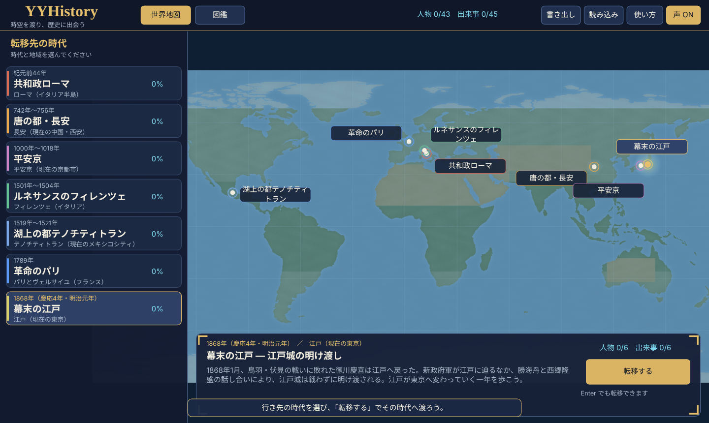
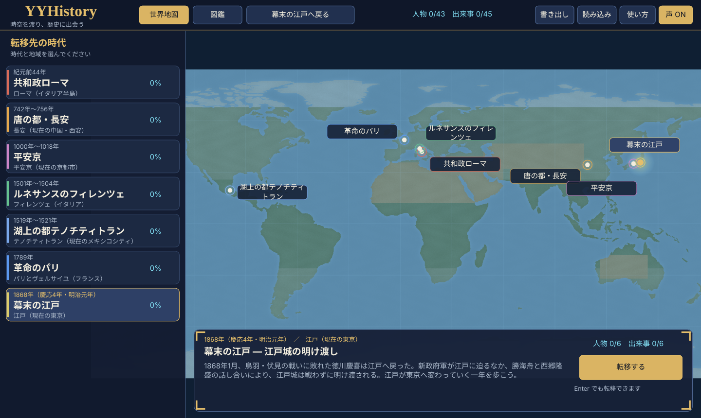
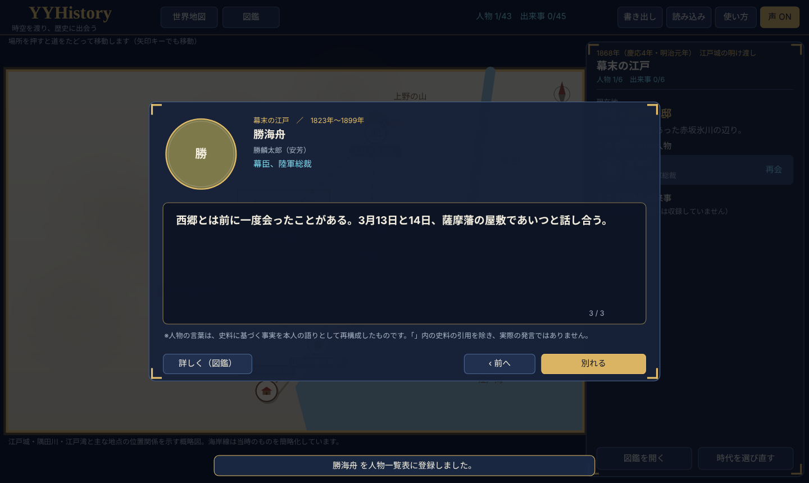
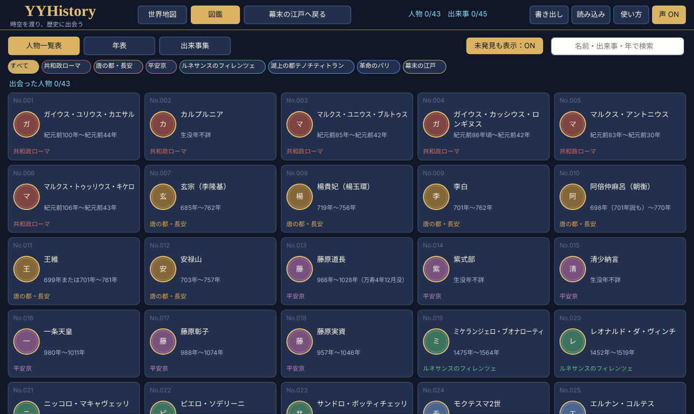
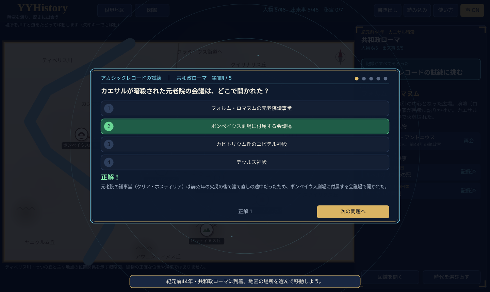

# 時空事件簿（YYHistory）

「時空事件簿」は、時代と地域を選んで歴史の現場へ「転移」し、その時代の街のミニマップを歩いて、人物に会い、出来事を観察する教育用のゲームです。出会った人物と観察した出来事は、図鑑（**人物一覧表**・**年表**・**出来事集**）に記録されます。その時代の記録をすべて集めると「**アカシックレコードの試練**」が始まり、四択問題に全問正解すると、その時代の**秘宝**が手に入ります。[YYEarth](https://github.com/ykwyuta/YYEarth) のRust・WebAssembly・Windows描画基盤を使っています。



## おはなし

きみは、歴史のロマンを追い求める「時空探偵」。タイムマシンに乗って様々な時代に行き、何が起こったのかを調べるのが仕事です。歴史上の人物に会うことはできますが、歴史を変えることはできません。探偵との会話は「時空の復元力」によって歴史から消えてしまうのです。

はじめて遊ぶと、小学生向けのやさしい言葉で書いた「はじめのおはなし」が始まります（8ページ。声 ONなら読み上げ、「とばす」で飛ばせます）。そのあとは、タイムマシンのナビ「クロノ」が、転移→移動→人物に会う→出来事を観察→図鑑、の順に、押す場所を光らせて案内します。はじめて人物と話し終えると、時空の復元力で会話が歴史から消えることを、絵と短い文で説明します（2回目からは短い演出だけ）。

はじめて行く時代では、「転移する」を押すと、クロノが「これから行く時代について、説明するね！」と言って、その時代の概略を5ページで説明します（どんな場所？／それまでに何があった？／今、何が起きている？／このあとどうなる？／見どころ）。前後の流れを知ってから人物の話を聞けるようにするためです。読み終えるか「とばして出発」で転移します。時代の札の「クロノの説明」と、地図の右の欄の「説明」から、いつでも読み直せます。文は `src/game/briefing.rs` にあります。

人物の話と出来事の場面では、クロノの「なぜ？ノート」に、子どもが持ちそうな疑問が並びます（例：カッシナの戦いの依頼なら「絵描きはだれからお金をもらうの？」「なぜカッシナの戦いを描くの？」）。押すとクロノが、場面を理解するのに必要な背景（パトロンのような社会のしくみ、そうした理由、前後の出来事とのつながり）を、やさしい言葉（漢字を使い、読み上げで補う）と史料つきで答え、読み上げます。関連する出来事へも飛べます。聞いたノートは図鑑の「なぜ？ノート」の欄に集まります。ノートは `src/notes.rs` にあり、67の時代のすべての出来事（312件）と人物（205人）に、計615項目を用意しています。すべての出来事と人物にノートがあることは、テストで確かめています。（以前の、難しそうな単語を自動で説明する「ことばメモ」は廃止しました。）

時代へ転移するときは、渦を巻く時空のトンネルの中を、針の回る時計がいくつも飛んでくる演出のあと、光に包まれて転移先の景色が現れます。

おはなしは「使い方」からいつでも読み直せ、クロノの案内はON／OFFできます。時空探偵とクロノは物語のキャラクターで、出会う人物と出来事は本当の歴史です（おはなしの中でもそう伝えています）。

## 読み上げ

声 ONのとき、はじめのおはなし、クロノの案内、時代の紹介、場所に着いたときの案内、人物の話（名前と肩書きから）、出来事の観察、図鑑の説明、試練の問題と解説、秘宝の説明を読み上げます。どの画面にも「🔊 きく」ボタンがあり（F4でも可）、声 OFFのときも押せばその画面を読み上げます。

- **熟語の読み**：YYEarthと同じしくみで、`src/speech_ja.tsv` の読み辞書（表記<TAB>読み、約1000語）により、音声に渡す文だけをかなに直します。画面の漢字はそのままです。人名（藤原道長→ふじわらのみちなが、阿倍仲麻呂→あべのなかまろ）、官職（執政官、摂政、翰林供奉）、年号（天宝、長保、慶応）、地名（土御門殿、朱雀大路、駿府）などを登録しています。同じ位置で最も長く一致する表記を優先し、一文字の漢字は一括で置き換えません（「后」は「の后」「后に」のように前後と組にして登録）。長安と平安京で読みの違う「東市・西市」（とうし・せいし／ひがしのいち・にしのいち）は時代ごとに読み分けます。
- **登録漏れの検査**：読み上げる文はすべて `src/game/voice.rs` で組み立てており、`cargo test` がそれらをすべて辞書に通して、漢字が2字以上続く箇所（＝未登録の熟語）が残らないことを確かめます。残っていれば、テストが失敗して `output/missing-readings.txt` に一覧を書き出します。人物や出来事を追加したら、この一覧の語を辞書に足してください。
- **iPad・iPhone**：Safariは、指で触れたときでないと音声を始められません。はじめて遊ぶときは表紙の「▶ はじめる」を押すと音声が使えるようになり、おはなしの1ページ目から読み上げます。読み込み中に先にタップした場合も、そのあとの案内を再生できます（YYEarthと同じ `web/speech.mjs`。`npm run test:voice` で確認）。長い文は文ごとに分けて順に読み、途中で止まりにくくしています。
- **言語**：本文は日本語だけなので、端末の言語が英語などでも日本語の音声と読み辞書で読みます。
- 端末に日本語の音声が無い場合や、ブラウザが音声合成に対応していない場合は読み上げられません。Windows版はSAPIの日本語音声を使います。

## 遊ぶ

```powershell
rustup target add wasm32-unknown-unknown
npm run build
npm run preview
```

ブラウザで http://localhost:8765/ を開きます。Node.js、Rust、プレビュー用のPythonが必要です。npmパッケージのインストールは不要です。Linux/macOSでは `npm run build` が `bash build.sh` を呼び出し、Rustが未導入ならrustupで導入し、WebAssemblyターゲットも用意します（ダウンロードにネット接続が必要です）。WindowsではRustと `wasm32-unknown-unknown` ターゲットを事前に用意してください。

Windows版は `cargo run --release --bin yyhistory-win`。ビルドした実行ファイルは `target/release/yyhistory-win.exe` です。

## 遊び方

1. **世界地図**：転移先の時代を選び、「転移する」（Enter）。
2. **時代のミニマップ**：場所を押すと、道をたどって移動します（矢印キーでも移動）。「人」の印はまだ会っていない人物、「！」はまだ観察していない出来事がある場所です。
3. **会う**：右の欄の人物を選ぶと、その人物のいる場面に出会います。「きいてみよう」から質問を選ぶと、人物がそのときの気持ちをまじえて答えます。答えを読んだあと、枠の外を押す（Enter・→キーでも可）と、まだきいていない次の質問へ進みます。すべての質問をきくと別れぎわのひとことになり、もう一度押すと会話を終えます。途中で終えたいときは「別れる」を押します。会った人物は人物一覧表に登録されます。
4. **観察する**：その場所で起きた出来事を選ぶと、何が起きたかを読めます。観察した出来事は出来事集と年表に記録されます。
5. **アカシックレコードの試練**：その時代の人物と出来事をすべて集めると、試練が始まります。時代と地域の理解を問う四択問題5問に答え、全問正解すると、その時代にゆかりのある実在の品が「秘宝」として手に入ります。一問ずつ正解と解説が出ます。間違えても、地図の右の欄から何度でも挑み直せます（1〜4のキーでも答えられます）。
6. **図鑑**：人物一覧表・年表・出来事集・秘宝を、時代で絞り込んだり検索したりして見返せます。未発見の項目には、どこで会える／観察できるかのヒントが出ます。「未発見も表示」をONにすると、授業や予習のためにすべての項目を読めます（記録はされません）。図鑑から「その場所へ転移」もできます。

F2：図鑑、F3：使い方、F11：全画面、Esc：戻る、Enter／Space：次へ・転移。









## 収録内容

| 時代 | 年代 | 人物 | 出来事 | 秘宝 |
|---|---|---|---|---|
| 法典の都バビロン（ハンムラビ王と法典） | 紀元前1754年ごろ | 2 | 5 | ハンムラビ法典の石碑 |
| アショーカ王のインド（戦いをやめた王） | 紀元前261年ごろ〜紀元前250年ごろ | 2 | 5 | サールナートのライオン柱頭 |
| 知恵の都アレクサンドリア（地球の大きさをはかる） | 紀元前240年ごろ | 2 | 4 | ファロスの灯台が刻まれた硬貨 |
| 秦の都・咸陽（始皇帝の中国統一） | 紀元前221年〜紀元前220年 | 2 | 5 | 始皇帝の詔を刻んだ分銅 |
| 共和政ローマ（カエサル暗殺） | 紀元前44年 | 6 | 5 | 「3月15日」のデナリウス銀貨 |
| 後漢の都・洛陽（蔡倫と紙） | 102年〜114年 | 3 | 4 | 放馬灘紙 |
| ナーランダー僧院（玄奘が学んだ大学） | 631年〜637年ごろ | 2 | 4 | ナーランダー僧院の印章 |
| 唐の都・長安（玄宗の天宝年間） | 742年〜756年 | 6 | 6 | 開元通宝 |
| 円城バグダード（知恵の館） | 820年〜833年ごろ | 3 | 4 | フワーリズミーの代数学の写本 |
| 平安京（藤原道長の時代） | 1000年〜1018年 | 6 | 6 | 『御堂関白記』自筆本 |
| 光の学者のカイロ（イブン・アル＝ハイサムと光学） | 1010年ごろ〜1021年 | 2 | 4 | 『光学の書』のラテン語版 |
| 北宋の都・開封（蘇頌の天文時計塔） | 1086年〜1094年 | 2 | 4 | 『新儀象法要』の星図 |
| モンゴルの都カラコルム（ルブルクの旅） | 1254年 | 3 | 5 | カラコルムの亀石 |
| アンコールの都（周達観が見たカンボジア） | 1296年〜1297年 | 3 | 5 | 『真臘風土記』 |
| 黄金のマリ王国（イブン・バットゥータの旅） | 1352年〜1353年 | 3 | 5 | カタルーニャ地図 |
| 海の十字路マラッカ（鄭和の大船団） | 1409年〜1411年 | 3 | 5 | 鄭和航海図 |
| サマルカンドの天文台（ウルグ・ベクと星の表） | 1420年〜1437年 | 3 | 5 | ウルグ・ベクの観測器の跡 |
| 朝鮮の都・漢陽（世宗と訓民正音） | 1434年〜1446年 | 3 | 6 | 『訓民正音』解例本 |
| マインツの印刷工房（グーテンベルクの活版印刷） | 1450年〜1457年 | 3 | 5 | グーテンベルク聖書 |
| カリブ海の島々（二つの世界が出会う） | 1492年〜1493年 | 3 | 4 | コロンブスの航海日誌の写し |
| ルネサンスのフィレンツェ（ダヴィデ像の完成） | 1501年〜1504年 | 5 | 6 | フィオリーノ金貨 |
| 湖上の都テノチティトラン（スペイン人の到来） | 1519年〜1521年 | 7 | 7 | 太陽の石 |
| ガリレオのヴェネツィア（望遠鏡で空を見る） | 1609年〜1610年 | 3 | 5 | ガリレオの望遠鏡 |
| 万有引力のケンブリッジ（ニュートンとプリンキピア） | 1684年〜1687年 | 2 | 4 | ニュートンの書きこみのある『プリンキピア』初版 |
| 独立宣言のフィラデルフィア（アメリカの独立） | 1776年 | 3 | 5 | ダンラップ版の独立宣言 |
| 革命のパリ（フランス革命の始まり） | 1789年 | 7 | 9 | バスティーユの鍵 |
| 寛政の江戸（伊能忠敬、測量の旅へ） | 1795年〜1800年 | 3 | 4 | 大日本沿海輿地全図（伊能図） |
| 紀州の春林軒（華岡青洲と麻酔の手術） | 1804年（文化元年） | 3 | 4 | 春林軒 |
| アンデス越え（サン・マルティンと南アメリカの独立） | 1816年〜1817年 | 3 | 5 | アンデス軍の旗 |
| 蒸気機関車の走る道（リヴァプール・アンド・マンチェスター鉄道） | 1829年〜1830年 | 3 | 4 | ロケット号 |
| ガラパゴス諸島（ダーウィンとビーグル号） | 1835年 | 3 | 5 | ダーウィンのフィンチの標本 |
| ワイタンギの浜（ワイタンギ条約） | 1840年 | 3 | 4 | ワイタンギ条約の原本 |
| 黒船の浦賀（ペリー来航） | 1853年〜1854年（嘉永6年〜7年） | 3 | 5 | 黒船を描いた瓦版 |
| コレラのロンドン（ブロード・ストリートの井戸） | 1854年〜1855年 | 3 | 5 | スノウのコレラの地図 |
| スクタリの病院（ナイチンゲールと看護） | 1854年〜1856年 | 3 | 5 | ナイチンゲールのランプ |
| 修道院のエンドウ畑（メンデルと遺伝の法則） | 1856年〜1866年 | 2 | 4 | メンデルの論文「植物雑種に関する実験」 |
| スエズ運河の開通（二つの海が結ばれる） | 1859年〜1869年 | 2 | 5 | スエズ運河開通の記念メダル |
| 赤十字のジュネーヴ（赤十字の誕生） | 1862年〜1864年 | 3 | 4 | 『ソルフェリーノの思い出』の初版 |
| 幕末の江戸（江戸城の明け渡し） | 1868年 | 6 | 6 | 五箇条の御誓文 |
| メンロパークの研究所（エジソンと電球） | 1877年〜1879年 | 3 | 5 | エジソンの白熱電球 |
| パスツールのパリ（狂犬病のワクチン） | 1885年〜1888年 | 3 | 5 | 白鳥の首のフラスコ |
| タスカンビアの春（ヘレン・ケラーとサリヴァン先生） | 1887年 | 3 | 4 | アイビー・グリーンの井戸のポンプ |
| 黄金法のリオ（ブラジルの奴隷制廃止） | 1888年 | 3 | 5 | 黄金法の原本 |
| ベルリンの研究所（北里柴三郎と血清療法） | 1889年〜1890年 | 3 | 3 | 北里式の嫌気性菌培養装置 |
| ジュパラのカルティニ（闇を越えて光へ） | 1899年〜1903年 | 3 | 5 | 『闇を越えて光へ』 |
| 明治の東京（津田梅子と女子英学塾） | 1900年 | 3 | 3 | 津田梅子の肖像の五千円札 |
| キティホークの砂丘（ライト兄弟の初飛行） | 1903年 | 3 | 4 | ライト・フライヤー号 |
| パナマ運河（山を越える水の階段） | 1905年〜1914年 | 2 | 4 | パナマ運河開通の記念金貨 |
| 鉄道の村ラサンス（シャーガスと見えない病） | 1907年〜1909年 | 3 | 4 | シャーガスの顕微鏡 |
| マチュ・ピチュ（雲の上の遺跡） | 1911年 | 3 | 5 | ペルーに戻った出土品 |
| 辛亥革命（皇帝のいない中国へ） | 1911年〜1912年 | 3 | 4 | 孫文の書「天下為公」 |
| 大戦下のフランス（キュリーとX線の車） | 1914年〜1918年 | 2 | 4 | キュリーの実験ノート |
| トロントの実験室（インスリンの発見） | 1921年〜1923年 | 3 | 4 | インスリンの特許証書 |
| 光の色が変わる日（ラマンとカルカッタの実験室） | 1921年〜1930年 | 2 | 4 | ラマンの分光器 |
| 新しい文字のトルコ（アタテュルクの文字改革） | 1928年〜1929年 | 2 | 5 | 黒板の前のケマルの写真 |
| 塩の行進（ガンディーと非暴力） | 1930年 | 3 | 4 | ガンディーの糸車（チャルカー） |
| カウナスの夏（杉原千畝と命のビザ） | 1940年 | 3 | 4 | 命のビザ |
| 独立の夜のデリー（インドの独立） | 1947年 | 3 | 5 | インド憲法の手書きの原本 |
| 二重らせんの発見（DNAの形を探して） | 1951年〜1953年 | 3 | 4 | DNAの二重らせんの模型 |
| アジア・アフリカ会議（バンドンに集まった国々） | 1955年 | 3 | 4 | アジア・アフリカ会議の最終声明 |
| 黒い星のガーナ（アフリカの独立） | 1957年 | 3 | 4 | ガーナの国旗 |
| 宇宙への第一歩（ガガーリンの宇宙飛行） | 1961年 | 3 | 4 | ボストーク1号の帰還カプセル |
| アブ・シンベル神殿（神殿の引っ越し） | 1964年〜1968年 | 2 | 5 | 世界遺産条約 |
| 古い本と新しい薬（屠呦呦とマラリアの薬） | 1969年〜1972年 | 1 | 4 | 『肘後備急方』 |
| 天然痘のない世界へ（天然痘の根絶） | 1977年〜1980年 | 2 | 4 | 二又針 |
| ベルリンの壁が開いた夜（冷戦の終わり） | 1989年〜1990年 | 3 | 5 | ベルリンの壁の一部 |
| 虹の国の誕生（マンデラと南アフリカ） | 1990年〜1994年 | 3 | 5 | 南アフリカの新しい国旗 |

合計 人物205人・出来事312件・試練の問題335問・秘宝67。データはすべて `src/history.rs` にあります。

近現代の10の時代（コレラのロンドン、スクタリ、ジュネーヴ、パスツール、タスカンビア、ベルリン、明治の東京、大戦下のフランス、トロント、カウナス）は、医師・看護師・科学者・教師・外交官など、人びとのために力を尽くした人たちの出来事を中心にしています。アレクサンドリア、洛陽、バグダード、漢陽、マインツ、ヴェネツィア、寛政の江戸、ガラパゴス、メンロパーク、キティホークの10の時代は、さまざまな時代と地域の発明と発見をテーマにしています。ナーランダー、塩の行進（インド）、マリ王国、アブ・シンベル（アフリカ）、カラコルム、サマルカンド（中央アジア）、アンコール、ジュパラ（東南アジア）、リオデジャネイロ、マチュ・ピチュ（南アメリカ）の10の時代は、ヨーロッパや東アジア以外の地域の出来事を扱っています。

歴史の転換期の20の時代は、地域が片寄らないように選んでいます：ハンムラビ法典のバビロン、トルコの文字改革（西アジア）、アショーカ王、インドの独立（南アジア）、始皇帝の統一、辛亥革命、ペリー来航（東アジア）、鄭和とマラッカ、アジア・アフリカ会議（東南アジア）、ガガーリンの宇宙飛行（中央アジア）、スエズ運河、ガーナの独立、マンデラと南アフリカ（アフリカ）、コロンブスとカリブ海、アメリカの独立宣言、アンデス越え、パナマ運河（アメリカ大陸）、ワイタンギ条約（オセアニア）、蒸気機関車の鉄道、ベルリンの壁（ヨーロッパ）。世界地図は、ニュージーランドと南アフリカまで入るように南へ広げました。

科学の進歩の10の時代は、さまざまな分野と地域から選んでいます：光の学者のカイロ（イブン・アル＝ハイサムと光学）、北宋の都・開封（蘇頌の天文時計塔）、万有引力のケンブリッジ（ニュートン）、紀州の春林軒（華岡青洲の全身麻酔）、修道院のエンドウ畑（メンデルの遺伝の法則）、鉄道の村ラサンス（シャーガス病の発見）、光の色が変わる日（ラマン効果）、二重らせんの発見（フランクリン、ワトソン、クリック）、古い本と新しい薬（屠呦呦とマラリアの薬）、天然痘のない世界へ（天然痘の根絶）。

必要な画像の一覧は `docs/images.md` にあります。はじめの37の時代の画像はそろっています。あとから加えた30の時代の画像（298枚）はまだ無く、図形で描いています。まだ無い画像だけを並べた不足画像リストは `docs/missing-images.md` にあり、`npm run images:missing` で作り直せます。

## 内容の正確さについて

教育目的のため、次の方針でまとめています。

- 年月日・人物の生没年・役職・出来事は、各項目に示した史料（一次史料と標準的な研究）に基づきます。各人物・出来事に「史料」を表示します。
- 日付に諸説があるもの、史料どうしで記述が食い違うもの、後世の創作で広まった話（「ブルトゥス、お前もか」、マリー・アントワネットの「お菓子」の言葉など）は、本文でその旨を説明しています。
- 生没年が分からない人物は「生没年不詳」、推定は「頃」と書きます。
- 和暦の月日は当時の暦（旧暦）のまま書き、西暦は年だけを添えています（例：「慶応4年（1868年）4月11日」）。
- **人物との会話**は、史料に伝わる出来事・逸話・人柄をもとに、その場面での気持ちを想像して書いたものです（会話の画面と「使い方」に記しています）。年・場所・行いなどの事実は史料に合わせ、望月の歌、シエイエスの『第三身分とは何か』、ミラボーの言葉のように史料に残る言葉は「」で示しています。人物は自分の未来を語らず、その後のことはクロノのなぜ？ノートで補います。会話の文は `src/talk.rs` にあります。
- 試練の問題は、ゲーム内の人物・出来事の記録で学べる内容から出題し、答えるたびに解説を示します。誤答の選択肢には、実在しない事柄や別の場面の事柄を使っています。
- 秘宝はすべて実在する（または実在した）品で、説明と所蔵先・史料を示しています。ゲームの中で「手に入る」のは図鑑への記録という意味です。
- 人物がいる場所は、その人物にゆかりのある場所です。いつもそこにいたという意味ではありません。
- ミニマップは位置関係を示す概略図で、建物の正確な位置・形・距離を示すものではありません。各地図の下に注記しています。

誤りに気づいた場合は `src/history.rs` の該当項目を直してください。`cargo test` で、人物・出来事・場所の対応、道のつながり、年代順の並びが検査されます。

## 画像

全110枚の生成画像を同梱しています。組み込みの `image_gen` で制作した復元イメージで、記録が残っている109枚の全文プロンプトと、全110枚の生成元ファイル名・画像のSHA-256を [生成記録](assets/images/generation-prompts.json) に保存しています。ローマの扉絵はプロンプトが未記録（`null`）です。史料原本や実物の正確な複製ではありません。画像が不足する場合は図形で描きます。

- **必要な画像の一覧**：[docs/images.md](docs/images.md)（全110枚。人物の肖像43・出来事の場面45・秘宝7・時代の扉絵7・時代の地図7・試練の背景1）。大きさ・形式・使う場所と、1枚ずつの描く内容と時代考証の注意を載せています。
- **置き場所**：`assets/images/` の下に、一覧のパスのとおりに置きます（例：`assets/images/portraits/caesar.jpg`）。ブラウザ版はビルド時に `dist/images/` へ写し、Windows版は exe の隣の `images/` かリポジトリの `assets/images/` から読みます。
- **作成漏れのチェック**：`npm run images:check` で、そろった枚数を種類ごとに表示し、まだ無い画像、大きさ・形式・透過が規格と違う画像、一覧に無い画像（パスの間違い）を報告します。`npm run images:report` で `output/images-report.md` にチェックリストを書き出します。`npm run images:missing` で、まだ無い画像だけを説明つきで並べた不足画像リスト `docs/missing-images.md` を作り直します。`--strict` を付けると、1枚でも抜けがあれば失敗します（公開前の確認用）。GitHub Actions では、規格と違う画像があればビルドを失敗させ、抜けは一覧の表示だけにしています。
- **一覧の更新**：一覧は `src/images.rs` がゲームのデータから作るので、人物や出来事を足すと必要な画像も増えます。`assets/images/manifest.json` と `docs/images.md` が古いと `cargo test` が失敗するので、`npm run images:list` で作り直してください。
- **表示**：肖像・出来事の場面・扉絵・地図には、ゲーム内で「イメージ」と表示します（肖像は円形に切り抜くので、顔を中央に）。絵地図の上には、ゲームが場所の印・名札・自分の位置を重ねます。

## 保存

会ったり観察したり秘宝を得たりすると自動保存し、起動時に読み込みます。ブラウザはIndexedDBの `yyhistory`、Windowsは `%APPDATA%\yyhistory\saves`。「書き出し」「読み込み」で `.yyhsav` のバックアップを移動できます。記録は時代・人物・出来事・ノートの固定IDで保存するので、時代を足したりデータを並べ替えたりしても記録の対応は変わりません（時代を番号で記録していた前の版の記録も、もとの7つの時代の並びで読み込みます。時代は年代順に並び、番号は時代を足すとずれますが、記録は影響を受けません）。記録にはバージョンとチェックサムを持たせ、途中で切れた記録や壊れたファイルを拒否します。秘宝の無い前の版の記録も読み込めます。旧版（写真帳）の記録は読み込めません。前の版の記録を読み込んだ場合は、導入（おはなしと案内）は済んだものとして扱います。

ブラウザ版で古い版が残って画面が新しくならないときは、「使い方」のいちばん下の「キャッシュを消して再読み込み」を押します。Service Worker と Cache Storage を消し、主なファイルを取り直してから読み込み直します。旅の記録（IndexedDB）と表示の設定は消えません。

## 検証

```powershell
cargo test --locked --lib --features headless
npm test                 # 読み込み・画像検査・音声（iPad向け初期化）・タッチ操作（スワイプと慣性スクロール）
npm run images:check
npm run build
node tools/wasm-smoke.mjs
cargo build --release --locked --bin yyhistory-win
```

Rustテスト：はじめての時代では転移の前にクロノの時代の説明が出ること（とばす・読み直す）、転移先の一覧・図鑑・右の欄で、項目の上をなぞってもスクロールし、押せば選べること（スマホ・iPad・パソコンの大きさ）、読み上げる文の熟語がすべて読み辞書にあること、🔊での読み直し、到着の案内とクロノの案内の順番、クロノのなぜ？ノート（疑問を押すと答えが開き、読み上げ、記録される。スマートフォンで読める長さ）、はじめての起動でおはなし→クロノの案内→はじめての会話後の復元力の説明→図鑑までの流れ、おはなしを飛ばす・読み直す、全時代への転移と、全場所への移動・全人物との会話・全出来事の観察、到着前や別の場所では会えないこと、記録がそろうまで試練が始まらないこと・一問でも間違えると秘宝が手に入らないこと・挑み直し、矢印キーでの移動、保存データの往復と破損・切断、図鑑の検索と絞り込み、通常／タッチ向けレイアウトの描画経路、データの整合性を確認します。

Wasmスモークテスト：生成した本番WasmをNodeで直接実行し、はじめのおはなし→世界地図→転移→ミニマップ→会う→観察→図鑑→記録の読み込み→試練で全問正解→秘宝→タッチ向け表示までを確認します。

## 地理と資料

- 世界地図の海岸線： [Natural Earth 1:110m land](https://github.com/nvkelso/natural-earth-vector/blob/master/geojson/ne_110m_land.geojson)。[パブリックドメイン](https://www.naturalearthdata.com/about/terms-of-use/)。元データ `assets/land.geojson` を同梱し、`python tools/make_map.py` で地図画像を再生成できます（Pillowが必要）。
- 歴史資料： [資料の一覧と扱い](docs/sources.md)。
- 基盤：YYEarthのWebGL2／Canvas2D、Direct3D11／Direct2D、保存・タッチ・音声の橋渡しを引き継いでいます。

GitHub Actionsでブラウザ版とWindows版をビルドし、成果物を保存します。`wrangler.toml` はYYHistory専用の名前です。公開には別途Cloudflare側の設定が必要です。
