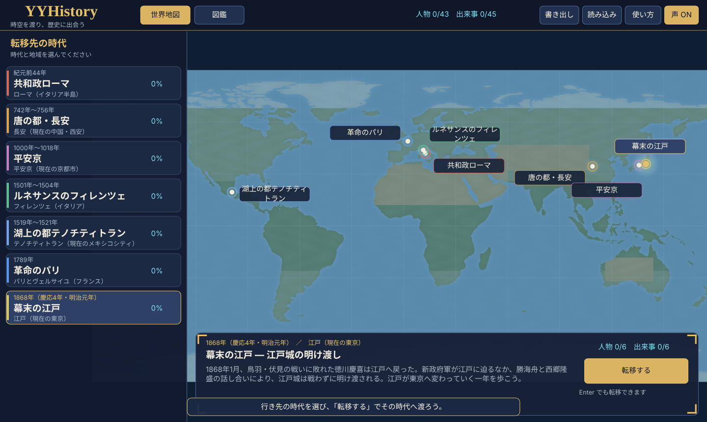
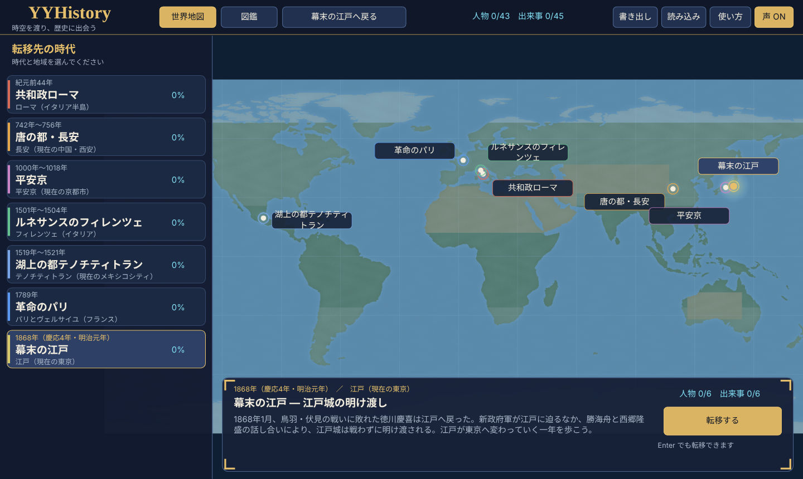
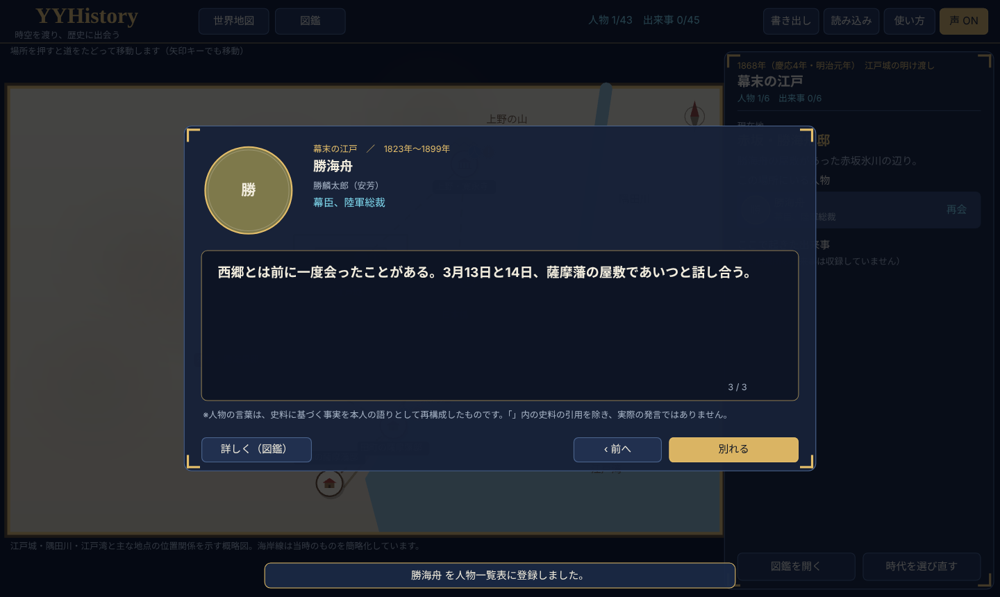
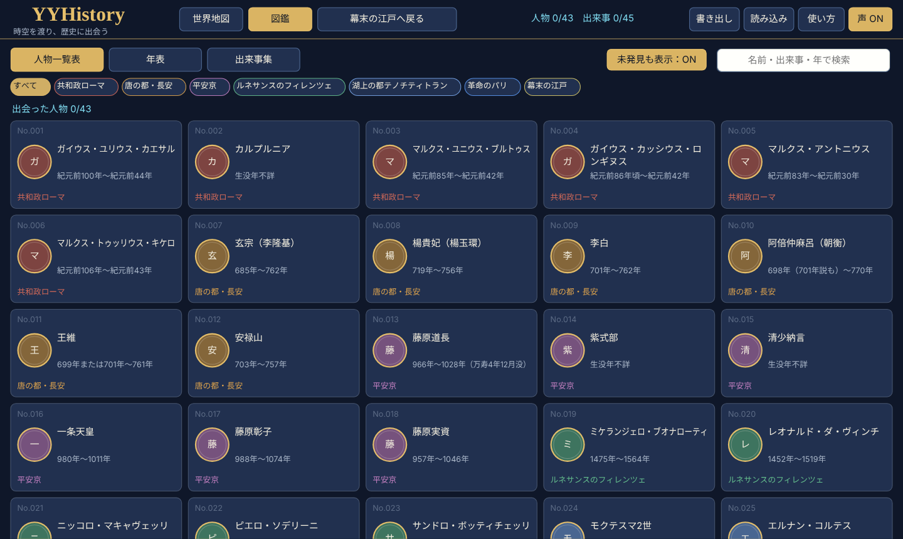
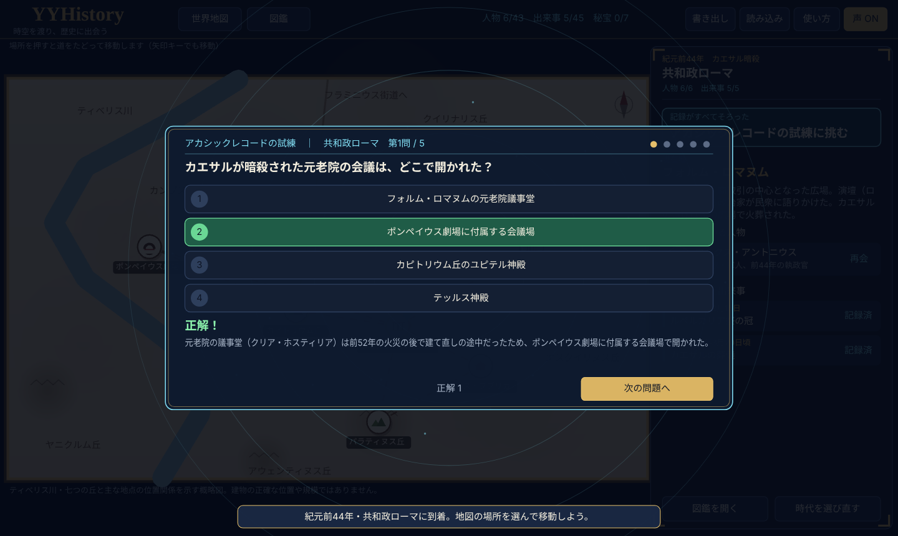

# YYHistory — 時空を渡り、歴史に出会う

時代と地域を選んで歴史の現場へ「転移」し、その時代の街のミニマップを歩いて、人物に会い、出来事を観察する教育用のゲームです。出会った人物と観察した出来事は、図鑑（**人物一覧表**・**年表**・**出来事集**）に記録されます。その時代の記録をすべて集めると「**アカシックレコードの試練**」が始まり、四択問題に全問正解すると、その時代の**秘宝**が手に入ります。[YYEarth](https://github.com/ykwyuta/YYEarth) のRust・WebAssembly・Windows描画基盤を使っています。



## おはなし

きみは、歴史のロマンを追い求める「時空探偵」。タイムマシンに乗って様々な時代に行き、何が起こったのかを調べるのが仕事です。歴史上の人物に会うことはできますが、歴史を変えることはできません。探偵との会話は「時空の復元力」によって歴史から消えてしまうのです。

はじめて遊ぶと、小学校低学年でも読めるよう、ひらがなを中心にした「はじめのおはなし」が始まります（8ページ。声 ONなら読み上げ、「とばす」で飛ばせます）。そのあとは、タイムマシンのナビ「クロノ」が、転移→移動→人物に会う→出来事を観察→図鑑、の順に、押す場所を光らせて案内します。はじめて人物と話し終えると、時空の復元力で会話が歴史から消えることを、絵と短い文で説明します（2回目からは短い演出だけ）。

人物の話・出来事・図鑑の説明・試練の解説に歴史の用語（執政官、元老院、遣唐使、摂政、第三身分、幕府など約110語）が出てくると、クロノが「ことばメモ」で、読みがなとこども向けのやさしい説明を出します。試練では、答えの手がかりにならないよう、答えたあとにだけ出します。教わった用語は図鑑の「ことば」の欄に集まります。用語と説明は `src/glossary.rs` にあり、どの用語もゲームの文の中に出てくることをテストで確かめています。

時代へ転移するときは、渦を巻く時空のトンネルの中を、針の回る時計がいくつも飛んでくる演出のあと、光に包まれて転移先の景色が現れます。

おはなしは「使い方」からいつでも読み直せ、クロノの案内はON／OFFできます。時空探偵とクロノは物語のキャラクターで、出会う人物と出来事は本当の歴史です（おはなしの中でもそう伝えています）。

## 読み上げ

声 ONのとき、はじめのおはなし、クロノの案内、時代の紹介、場所に着いたときの案内、人物の話（名前と肩書き・ことばメモつき）、出来事の観察、図鑑の説明、試練の問題と解説、秘宝の説明を読み上げます。どの画面にも「🔊 きく」ボタンがあり（F4でも可）、声 OFFのときも押せばその画面を読み上げます。

- **熟語の読み**：YYEarthと同じしくみで、`src/speech_ja.tsv` の読み辞書（表記<TAB>読み、約1000語）により、音声に渡す文だけをかなに直します。画面の漢字はそのままです。人名（藤原道長→ふじわらのみちなが、阿倍仲麻呂→あべのなかまろ）、官職（執政官、摂政、翰林供奉）、年号（天宝、長保、慶応）、地名（土御門殿、朱雀大路、駿府）などを登録しています。同じ位置で最も長く一致する表記を優先し、一文字の漢字は一括で置き換えません（「后」は「の后」「后に」のように前後と組にして登録）。長安と平安京で読みの違う「東市・西市」（とうし・せいし／ひがしのいち・にしのいち）は時代ごとに読み分けます。
- **登録漏れの検査**：読み上げる文はすべて `src/game/voice.rs` で組み立てており、`cargo test` がそれらをすべて辞書に通して、漢字が2字以上続く箇所（＝未登録の熟語）が残らないことを確かめます。残っていれば、テストが失敗して `output/missing-readings.txt` に一覧を書き出します。人物や出来事を追加したら、この一覧の語を辞書に足してください。
- **iPad・iPhone**：Safariは、指で触れたときでないと音声を始められません。はじめて遊ぶときは表紙の「▶ はじめる」を押すと音声が使えるようになり、おはなしの1ページ目から読み上げます。読み込み中に先にタップした場合も、そのあとの案内を再生できます（YYEarthと同じ `web/speech.mjs`。`npm run test:voice` で確認）。長い文は文ごとに分けて順に読み、途中で止まりにくくしています。
- **言語**：本文は日本語だけなので、端末の言語が英語などでも日本語の音声と読み辞書で読みます。
- 端末に日本語の音声が無い場合や、ブラウザが音声合成に対応していない場合は読み上げられません。Windows版はSAPIの日本語音声を使います。

## 遊ぶ

```powershell
rustup target add wasm32-unknown-unknown
npm run build
npm run preview
```

ブラウザで http://localhost:8765/ を開きます。Node.js、Rust、プレビュー用のPythonが必要です。npmパッケージのインストールは不要です。Linux/macOSでは `npm run build` が `bash build.sh` を呼び出し、Rustが未導入ならrustupで導入し、WebAssemblyターゲットも用意します（ダウンロードにネット接続が必要です）。WindowsではRustと `wasm32-unknown-unknown` ターゲットを事前に用意してください。

Windows版は `cargo run --release --bin yyhistory-win`。ビルドした実行ファイルは `target/release/yyhistory-win.exe` です。

## 遊び方

1. **世界地図**：転移先の時代を選び、「転移する」（Enter）。
2. **時代のミニマップ**：場所を押すと、道をたどって移動します（矢印キーでも移動）。「人」の印はまだ会っていない人物、「！」はまだ観察していない出来事がある場所です。
3. **会う**：右の欄の人物を選ぶと、その人物が史実に基づいて自分のことを語ります。会った人物は人物一覧表に登録されます。
4. **観察する**：その場所で起きた出来事を選ぶと、何が起きたかを読めます。観察した出来事は出来事集と年表に記録されます。
5. **アカシックレコードの試練**：その時代の人物と出来事をすべて集めると、試練が始まります。時代と地域の理解を問う四択問題5問に答え、全問正解すると、その時代にゆかりのある実在の品が「秘宝」として手に入ります。一問ずつ正解と解説が出ます。間違えても、地図の右の欄から何度でも挑み直せます（1〜4のキーでも答えられます）。
6. **図鑑**：人物一覧表・年表・出来事集・秘宝を、時代で絞り込んだり検索したりして見返せます。未発見の項目には、どこで会える／観察できるかのヒントが出ます。「未発見も表示」をONにすると、授業や予習のためにすべての項目を読めます（記録はされません）。図鑑から「その場所へ転移」もできます。

F2：図鑑、F3：使い方、F11：全画面、Esc：戻る、Enter／Space：次へ・転移。









## 収録内容

| 時代 | 年代 | 人物 | 出来事 | 秘宝 |
|---|---|---|---|---|
| 共和政ローマ（カエサル暗殺） | 紀元前44年 | 6 | 5 | 「3月15日」のデナリウス銀貨 |
| 唐の都・長安（玄宗の天宝年間） | 742年〜756年 | 6 | 6 | 開元通宝 |
| 平安京（藤原道長の時代） | 1000年〜1018年 | 6 | 6 | 『御堂関白記』自筆本 |
| ルネサンスのフィレンツェ（ダヴィデ像の完成） | 1501年〜1504年 | 5 | 6 | フィオリーノ金貨 |
| 湖上の都テノチティトラン（スペイン人の到来） | 1519年〜1521年 | 7 | 7 | 太陽の石 |
| 革命のパリ（フランス革命の始まり） | 1789年 | 7 | 9 | バスティーユの鍵 |
| 幕末の江戸（江戸城の明け渡し） | 1868年 | 6 | 6 | 五箇条の御誓文 |

合計 人物43人・出来事45件・試練の問題35問・秘宝7つ。データはすべて `src/history.rs` にあります。

## 内容の正確さについて

教育目的のため、次の方針でまとめています。

- 年月日・人物の生没年・役職・出来事は、各項目に示した史料（一次史料と標準的な研究）に基づきます。各人物・出来事に「史料」を表示します。
- 日付に諸説があるもの、史料どうしで記述が食い違うもの、後世の創作で広まった話（「ブルトゥス、お前もか」、マリー・アントワネットの「お菓子」の言葉など）は、本文でその旨を説明しています。
- 生没年が分からない人物は「生没年不詳」、推定は「頃」と書きます。
- 和暦の月日は当時の暦（旧暦）のまま書き、西暦は年だけを添えています（例：「慶応4年（1868年）4月11日」）。
- **人物の言葉**は、史料にある事実を本人の一人称の語りとして再構成した教材です。「」で示した史料の引用（『紫式部日記』『枕草子』の書き出し、望月の歌、シエイエスの言葉など）を除き、実際の発言ではありません（「使い方」に記しています）。
- 試練の問題は、ゲーム内の人物・出来事の記録で学べる内容から出題し、答えるたびに解説を示します。誤答の選択肢には、実在しない事柄や別の場面の事柄を使っています。
- 秘宝はすべて実在する（または実在した）品で、説明と所蔵先・史料を示しています。ゲームの中で「手に入る」のは図鑑への記録という意味です。
- 人物がいる場所は、その人物にゆかりのある場所です。いつもそこにいたという意味ではありません。
- ミニマップは位置関係を示す概略図で、建物の正確な位置・形・距離を示すものではありません。各地図の下に注記しています。

誤りに気づいた場合は `src/history.rs` の該当項目を直してください。`cargo test` で、人物・出来事・場所の対応、道のつながり、年代順の並びが検査されます。

## 画像

全110枚の生成画像を同梱しています。組み込みの `image_gen` で制作した復元イメージで、記録が残っている109枚の全文プロンプトと、全110枚の生成元ファイル名・画像のSHA-256を [生成記録](assets/images/generation-prompts.json) に保存しています。ローマの扉絵はプロンプトが未記録（`null`）です。史料原本や実物の正確な複製ではありません。画像が不足する場合は図形で描きます。

- **必要な画像の一覧**：[docs/images.md](docs/images.md)（全110枚。人物の肖像43・出来事の場面45・秘宝7・時代の扉絵7・時代の地図7・試練の背景1）。大きさ・形式・使う場所と、1枚ずつの描く内容と時代考証の注意を載せています。
- **置き場所**：`assets/images/` の下に、一覧のパスのとおりに置きます（例：`assets/images/portraits/caesar.jpg`）。ブラウザ版はビルド時に `dist/images/` へ写し、Windows版は exe の隣の `images/` かリポジトリの `assets/images/` から読みます。
- **作成漏れのチェック**：`npm run images:check` で、そろった枚数を種類ごとに表示し、まだ無い画像、大きさ・形式・透過が規格と違う画像、一覧に無い画像（パスの間違い）を報告します。`npm run images:report` で `output/images-report.md` にチェックリストを書き出します。`--strict` を付けると、1枚でも抜けがあれば失敗します（公開前の確認用）。GitHub Actions では、規格と違う画像があればビルドを失敗させ、抜けは一覧の表示だけにしています。
- **一覧の更新**：一覧は `src/images.rs` がゲームのデータから作るので、人物や出来事を足すと必要な画像も増えます。`assets/images/manifest.json` と `docs/images.md` が古いと `cargo test` が失敗するので、`npm run images:list` で作り直してください。
- **表示**：肖像・出来事の場面・扉絵・地図には、ゲーム内で「イメージ」と表示します（肖像は円形に切り抜くので、顔を中央に）。絵地図の上には、ゲームが場所の印・名札・自分の位置を重ねます。

## 保存

会ったり観察したり秘宝を得たりすると自動保存し、起動時に読み込みます。ブラウザはIndexedDBの `yyhistory`、Windowsは `%APPDATA%\yyhistory\saves`。「書き出し」「読み込み」で `.yyhsav` のバックアップを移動できます。記録は人物・出来事の固定IDで保存するので、データの並び替えで記録の対応は変わりません。記録にはバージョンとチェックサムを持たせ、途中で切れた記録や壊れたファイルを拒否します。秘宝の無い前の版の記録も読み込めます。旧版（写真帳）の記録は読み込めません。前の版の記録を読み込んだ場合は、導入（おはなしと案内）は済んだものとして扱います。

## 検証

```powershell
cargo test --locked --lib --features headless
npm test                 # 読み込み・画像検査・音声（iPad向け初期化）・タッチ操作（スワイプと慣性スクロール）
npm run images:check
npm run build
node tools/wasm-smoke.mjs
cargo build --release --locked --bin yyhistory-win
```

Rustテスト：転移先の一覧・図鑑・右の欄で、項目の上をなぞってもスクロールし、押せば選べること（スマホ・iPad・パソコンの大きさ）、読み上げる文の熟語がすべて読み辞書にあること、🔊での読み直し、到着の案内とクロノの案内の順番、クロノのことばメモ（用語の説明・記録・試練では答えたあとだけ）、はじめての起動でおはなし→クロノの案内→はじめての会話後の復元力の説明→図鑑までの流れ、おはなしを飛ばす・読み直す、全時代への転移と、全場所への移動・全人物との会話・全出来事の観察、到着前や別の場所では会えないこと、記録がそろうまで試練が始まらないこと・一問でも間違えると秘宝が手に入らないこと・挑み直し、矢印キーでの移動、保存データの往復と破損・切断、図鑑の検索と絞り込み、通常／タッチ向けレイアウトの描画経路、データの整合性を確認します。

Wasmスモークテスト：生成した本番WasmをNodeで直接実行し、はじめのおはなし→世界地図→転移→ミニマップ→会う→観察→図鑑→記録の読み込み→試練で全問正解→秘宝→タッチ向け表示までを確認します。

## 地理と資料

- 世界地図の海岸線： [Natural Earth 1:110m land](https://github.com/nvkelso/natural-earth-vector/blob/master/geojson/ne_110m_land.geojson)。[パブリックドメイン](https://www.naturalearthdata.com/about/terms-of-use/)。元データ `assets/land.geojson` を同梱し、`python tools/make_map.py` で地図画像を再生成できます（Pillowが必要）。
- 歴史資料： [資料の一覧と扱い](docs/sources.md)。
- 基盤：YYEarthのWebGL2／Canvas2D、Direct3D11／Direct2D、保存・タッチ・音声の橋渡しを引き継いでいます。

GitHub Actionsでブラウザ版とWindows版をビルドし、成果物を保存します。`wrangler.toml` はYYHistory専用の名前です。公開には別途Cloudflare側の設定が必要です。
