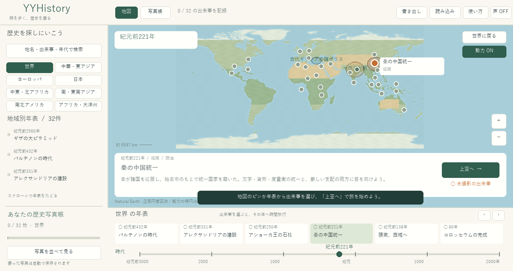

# YYHistory — 時を歩く、歴史を撮る

[YYEarth](https://github.com/ykwyuta/YYEarth) のRust・WebAssembly・Windows描画基盤を使った、歴史探索と写真収集のゲームです。地図を動かし、時代を選び、出来事の現場を訪ねて地域別の歴史写真帳を作ります。



*本番Wasmの描画命令から作成したオフラインのレイアウト確認画像。*

## 遊ぶ

```powershell
rustup target add wasm32-unknown-unknown
npm run build
npm run preview
```

ブラウザで http://localhost:8765/ を開きます。Node.js、Rust、プレビュー用のPythonが必要です。npmパッケージのインストールは不要です。Linux/macOSでは `bash build.sh` でもビルドできます。

Windows版は `cargo run --release --bin yyhistory-win`。ビルドした実行ファイルは `target/release/yyhistory-win.exe` です。

## 探索と撮影

1. **世界地図**：ドラッグで移動、ホイール・＋−で拡大縮小。世界全体から地域へ。オフラインのNatural Earth海岸線を使います。
2. **地域と時代**：中華・東アジア、ヨーロッパ、日本、西アジア・北アフリカ、南・東南アジア、南北アメリカ、アフリカ・オセアニアの年表。ピンや出来事を選ぶと、その年へ移動します。時間軸では紀元前3000年〜西暦2000年の任意の年を選べます。
3. **国と勢力**：秦・漢・唐・宋・モンゴル・明・清・ローマなど、年代に応じた名称と影響圏の概略を表示します。
4. **上空**：「上空へ」でデフォルメした街の鳥瞰図へ。川、道、建物、広場を眺められます。
5. **現場**：「現場に降りる」でストリートビュー風の復元風景へ。ドラッグまたは左右キーで向きを変え、ホイールでレンズを調整します。
6. **写真**：Spaceまたは撮影ボタン。正面への向きと拡大率で★1〜3を採点。より良い写真に撮り直せます。撮影した画像のサムネイルが地域別年表に加わります。
7. **写真帳**：写真を地域別・年代順に並べ、クリックして拡大し、解説と参照資料を読めます。

初版には32件の出来事を収録しています。例：秦の統一、長安の交流、鄭和の航海、活版印刷、ルネサンス、フランス革命、平城京、江戸、明治、アメリカ独立宣言、動力飛行、月着陸の地上管制、ベルリンの壁の開放。

F2：写真帳、F3：使い方、F11：全画面、Esc：戻る、Enter：上空／現場、`,` `.`：前後の出来事。

## 保存

撮影時に自動保存し、起動時に読み込みます。ブラウザはIndexedDBの `yyhistory`、Windowsは `%APPDATA%\yyhistory\saves`。YYEarthのセーブとは別です。「書き出し」「読み込み」で `.yyhsav` のバックアップを移動できます。

写真は出来事ID・方位・レンズ・撮影時刻を保存し、同じ描画から構図を再現します。年表の写真画像はその場面の三角形をソフトウェアでラスタライズしたものです。独立したJPEG画像の書き出し機能はまだありません。記録にはバージョンとチェックサムを持たせ、途中で切れた記録や壊れたファイルを拒否します。

## 表現と収録範囲

街は地域と年代を参考にした**創作を含むデフォルメ復元**です。実際の航空写真や360度写真、測量に基づく街路の再現ではありません。撮影位置は出来事ごとに用意した一つの観察地点です。勢力の楕円は交流・影響圏の概略であり、歴史上の国境、時期ごとの正確な領土、現代の領有権を示しません。全世界・全年代の国家や出来事を網羅していません。UIと解説は現在日本語です。

出来事の基本情報と資料URLは `src/history.rs`、描画は `src/scene.rs`、操作と写真帳は `src/game.rs` にあります。写真の保存は出来事の固定IDを使うため、出来事一覧の並び替えで収録済み写真の対応は変わりません。将来、描画を変更すると保存済み写真の見た目も変わり得ます。

## 検証

```powershell
cargo test --locked --lib --features headless
npm test
npm run build
node tools/wasm-smoke.mjs
cargo build --release --locked --bin yyhistory-win
```

Rustテスト：全出来事への移動・撮影・復元、撮影条件、地域別写真の絞り込み、検索、保存データの破損・切断、写真のピクセル一致、通常／タッチ向けレイアウトの描画経路を確認。

Wasmスモークテスト：生成した本番WasmをNodeで直接実行し、地図→上空→現場→撮影→写真帳→記録読み込み→タッチ向け表示までを確認します。ブラウザのWebGLや入力デバイスそのものの検証ではありません。

オフラインの描画確認画像は `cargo test --lib --features headless render_postcards -- --ignored` で `output/review/` に出力できます。`node tools/wasm-smoke.mjs` の描画記録を `python tools/render_review.py` でレイアウト画像にできます（PillowとWindowsの游ゴシックフォントが必要）。ブラウザ画面のスクリーンショットとは異なります。

## 地理と資料

- 海岸線： [Natural Earth 1:110m land](https://github.com/nvkelso/natural-earth-vector/blob/master/geojson/ne_110m_land.geojson)。[パブリックドメイン](https://www.naturalearthdata.com/about/terms-of-use/)。元データ `assets/land.geojson` を同梱し、`python tools/make_map.py` で地図画像を再生成できます（Pillowが必要）。
- 年代・歴史資料：各項目に博物館、文書館、文化遺産機関などのURLを収録。解説は独自の要約です。[資料の一覧と扱い](docs/sources.md)。
- 基盤：YYEarthのWebGL2／Canvas2D、Direct3D11／Direct2D、保存・タッチ・音声の橋渡しを引き継いでいます。

GitHub Actionsでブラウザ版とWindows版をビルドし、成果物を保存します。`wrangler.toml` はYYHistory専用の名前です。公開には別途Cloudflare側の設定が必要です。
